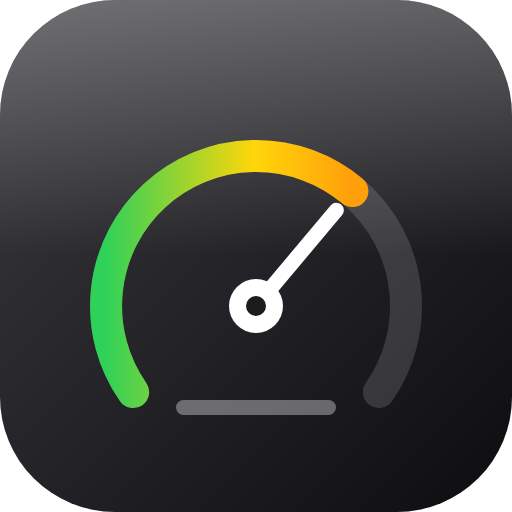
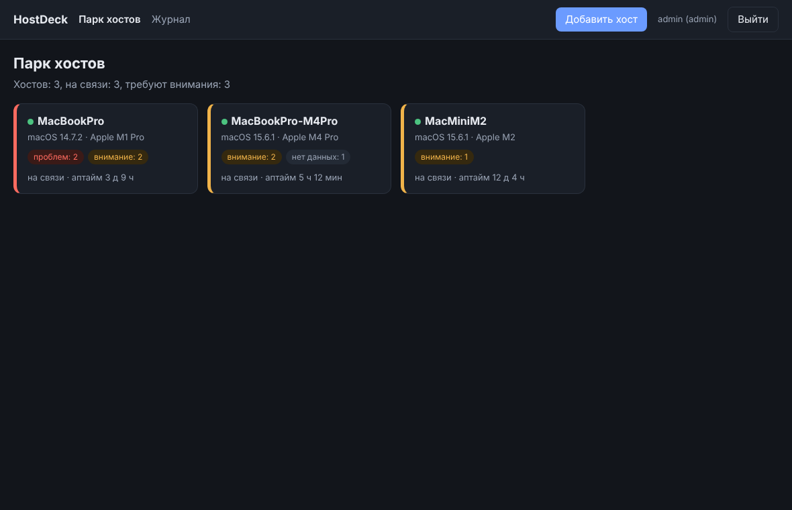
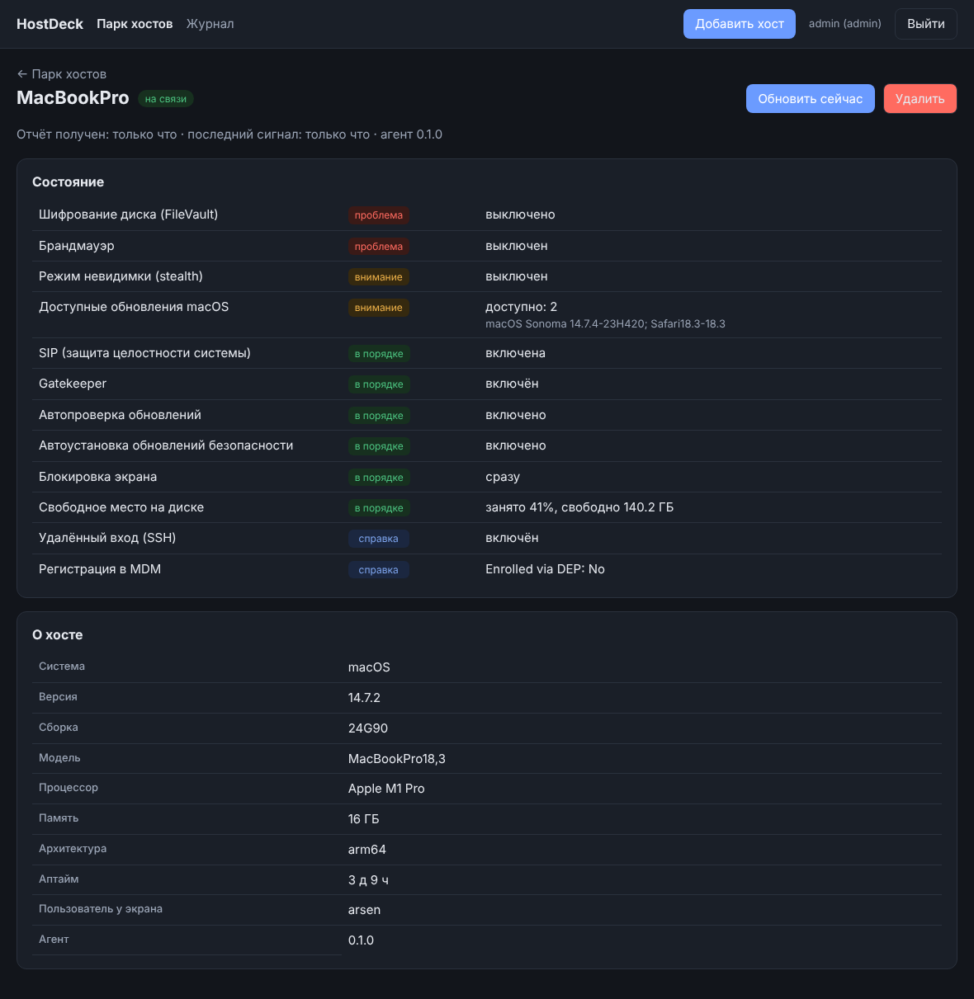
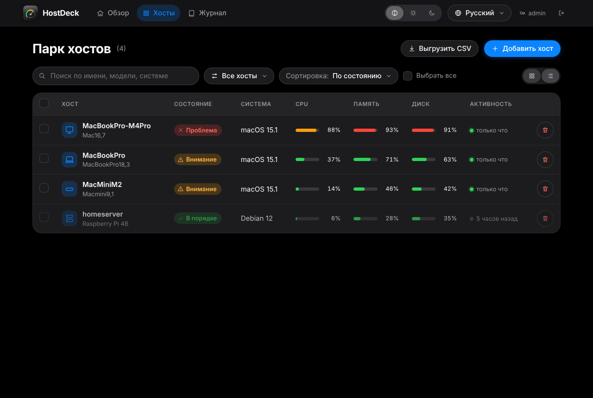
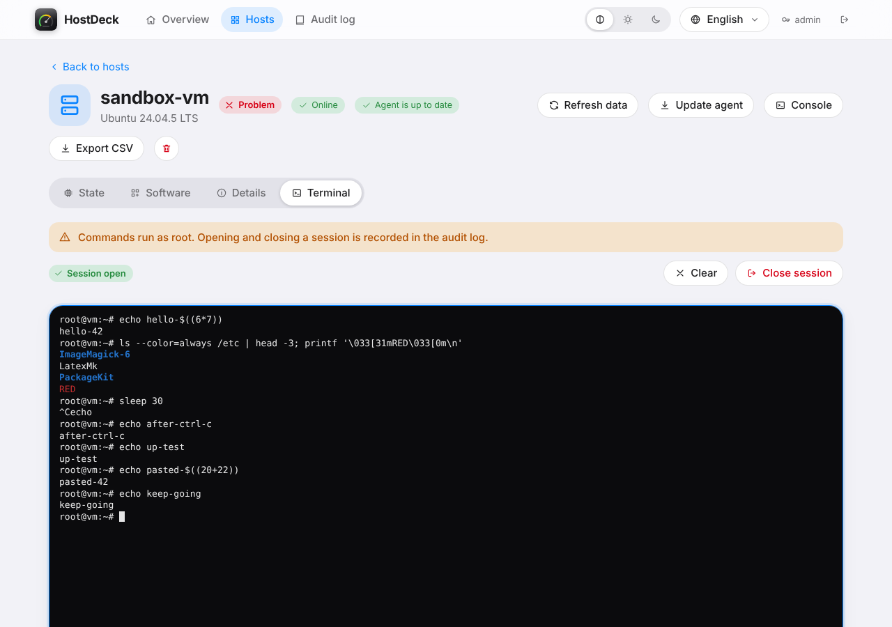

<p align="center"></p>

# HostDeck

Веб-интерфейс для парка хостов домашней лаборатории: карточки с состоянием безопасности, подробности по каждому хосту, список ПО и (позже) консоль в браузере. Начато с macOS.



*Демо-данные: три условных Mac.*

> Проект в работе. Команды, обходные пути ("костыли") и список недоделанного: [docs/lab-notes.md](docs/lab-notes.md). Развёртывание в Podman: [docs/podman.md](docs/podman.md).

## Что умеет сейчас

- **Обзор** — первая страница: что это, как подключить хост, ссылки, сводка по парку.
- **Хосты** — плитки или список (переключатель), поиск, фильтр по состоянию, сортировка, флажки для массовых действий, индикаторы CPU / памяти / диска.
- **Хост** — стрелочные приборы (процессор, память, диск, батарея или нагрузка), проверки безопасности, вкладка «ПО» (приложения, Homebrew, Cask; поиск и фильтр по источнику), сведения.
- **Выгрузка в CSV** — одного хоста (сведения, проверки и всё ПО в одном файле) и парка целиком или только выбранных. UTF-8 с BOM, открывается в Excel и Numbers; ячейки, начинающиеся с `=`, `+`, `-`, `@`, экранируются.
- Тёмная и светлая темы (или «как в системе»), русский и английский язык, оформление в стиле Apple. Диалоги и уведомления свои, без `alert` и `confirm` браузера.
- Кнопка «Обновить данные»: сервер ставит команду в очередь, агент подхватывает её сразу (длинный опрос).
- **Проверки Linux** — SELinux, firewalld/ufw, правила iptables/nftables, sshd (root и пароли), обновления пакетов, перезагрузка, auditd, время, сбойные службы systemd, LUKS
- **Журнал действий** — лента понятных событий по дням: вход, подключение и удаление хостов, консоль, запросы данных; фильтр и поиск. Имена удалённых хостов остаются в записях
- **Удаление хостов** — из списка, плитки и панели выбранных (в том числе несколько сразу); хост удаляется из базы вместе со всеми данными
- **Справка по проверкам** — при наведении на значок статуса появляется подсказка: что проверяется, чем опасно отклонение, как исправить (с командой). Тексты в `server/app/static/help.js`
- **Инструкция администратора** — кнопка на главной (подключение, консоль, обслуживание, безопасность)
- Регистрация хоста по одноразовому токену, роли `admin` / `operator` / `viewer`, журнал событий.








*Демо-данные.*

## Консоль root в браузере

Вкладка «Терминал» в карточке хоста (и кнопка «Консоль») открывает интерактивную оболочку **от root**: псевдотерминал на хосте, вывод в браузер по SSE, ввод запросами POST. Работают цвета, Tab, стрелки и история, Ctrl+C, `less`, `top`, `vim` (собственный эмулятор терминала без внешних библиотек).

Защита, потому что это полный доступ к хосту:

- только роль `admin`; перед открытием сессии диалог-предупреждение;
- консоль **выключена по умолчанию** и включается только на самом хосте: `hostdeck-agent enroll … -terminal`, `HOSTDECK_TERMINAL=1` в команде установки или `"allow_terminal": true` в `agent.json`. Взломанный сервер сам включить её не сможет;
- в журнал пишутся открытие, закрытие (длительность, объём ввода и вывода) и отказ; содержимое команд не записывается, потому что в потоке бывают пароли;
- сессия закрывается после 15 минут без ввода, не больше двух сессий на хост;
- за обратным прокси нужно отключить буферизацию SSE (`proxy_buffering off` для `/api/term/`; сервер также шлёт `X-Accel-Buffering: no`).

## Как устроено

```
 Mac (агент, root)  ──HTTPS, исходящее──▶  HostDeck (Starlette + SQLite)  ◀── браузер
   hostdeck-agent                              за обратным прокси с TLS
```

- **Агент** — один бинарник на Go без внешних зависимостей. Сам подключается к серверу (порты на Mac не открываются), раз в 15 минут шлёт состояние, раз в минуту — метрики для приборов, раз в сутки — список ПО, а между отчётами отчётами держит длинный опрос в ожидании команд.
- **Сервер** — Python, `starlette` + `uvicorn` + SQLite. Один контейнер, данные в `/data`.
- Вместо WebSocket используются обычный HTTPS (длинный опрос) и, на этапе 3, SSE + POST для терминала: никаких внешних библиотек у агента и меньше сюрпризов за прокси.

## Быстрый старт

Сервер:

```bash
cp .env.example .env        # задайте HOSTDECK_ADMIN_PASSWORD
docker compose up -d --build
```

Для Podman на RED OS (rootless, Quadlet, секрет для пароля) см. [docs/podman.md](docs/podman.md).

Откройте сервис через ваш обратный прокси с TLS и войдите под `admin`. Порт 8080 слушает только `127.0.0.1`.

Агент на хосте (macOS или Linux): сервер сам отдаёт скрипт установки и бинарники агента (проверяется SHA-256).

1. В веб-интерфейсе: **Добавить хост**. Окно выдаст одноразовый токен (24 часа) и готовую команду.
2. Выполните её на хосте:

```bash
curl -fsSL https://hostdeck.example.test/install.sh | sudo bash -s -- <токен> [имя]
```

Скрипт определяет систему и архитектуру, скачивает агента, сверяет контрольную сумму, регистрирует хост и ставит службу: launchd на macOS (`local.hostdeck.agent`, журнал `/var/log/hostdeck-agent.log`) или systemd на Linux (`hostdeck-agent`). Дополнительно через переменные перед `bash`: `HOSTDECK_TERMINAL=1` (разрешить root-консоль), `HOSTDECK_CA=/путь/ca.pem` (если сервер подписан внутренним CA). Та же команда без токена обновляет установленный агент. Удаление: `sudo scripts/uninstall.sh`.

На Linux реализован только минимальный набор данных (метрики, ПО, консоль); проверки безопасности есть пока только для macOS.

Агент работает от root: без этого нельзя прочитать `fdesetup`, `systemsetup`, `socketfilterfw`. Код агента только читает состояние (см. `agent/collect_darwin.go`).

## Безопасность

- Агент общается только по HTTPS; `http` разрешён лишь для `localhost` (отладка).
- Токен регистрации одноразовый и хранится на сервере в виде хеша, ключ хоста тоже (SHA-256). Файл конфига агента — `0600`.
- Вход: пароли хешируются `scrypt`, сессия в `HttpOnly` + `SameSite=Strict` cookie, ограничение числа неудачных входов, JSON-only API (форма с чужого сайта не пройдёт).
- Заголовки `Content-Security-Policy`, `X-Content-Type-Options`, `Referrer-Policy`; в интерфейсе нет вставки данных через `innerHTML`.
- Журнал: входы, неудачные входы, создание токенов, регистрация и удаление хостов, запросы обновления.
- Планируется для терминала: отдельная роль, выключен по умолчанию на каждом хосте, запись всех сессий в журнал, оболочка не от root.

## Проверки macOS

| Проверка | Источник |
|---|---|
| FileVault | `fdesetup status` |
| SIP | `csrutil status` |
| Gatekeeper | `spctl --status` |
| Брандмауэр, stealth | `socketfilterfw --getglobalstate`, `--getstealthmode` |
| Автообновления | `defaults read /Library/Preferences/com.apple.SoftwareUpdate` |
| Доступные обновления | `softwareupdate --list` (раз в 6 часов, в фоне) |
| Блокировка экрана | `sysadminctl -screenLock status` |
| SSH | `systemsetup -getremotelogin` |
| MDM | `profiles status -type enrollment` |
| Диск | `statfs /` |

Метрики для приборов: `top -l 2` (CPU), `vm_stat` и `sysctl hw.memsize` (память), `vm.swapusage`, `vm.loadavg`, `pmset -g batt`. Список ПО: `system_profiler SPApplicationsDataType` и каталоги Homebrew (`Cellar`, `Caskroom`). Температур нет: macOS отдаёт их только через `powermetrics` с повышенными правами.

Разбор вывода вынесен в чистые функции (`agent/parse.go`) и покрыт тестами.

## Разработка и тесты

```bash
make test       # unit-тесты агента + сквозной тест (сервер + агент)
python3 tests/ui_check.py shots/   # интерфейс в настоящем браузере (Playwright): темы, языки, диалоги, CSV, скриншоты
make agents     # сборка под macOS arm64/amd64 и Linux в dist/
```

Состояние проверки: разбор вывода команд проверен тестами на образцах, сервер и цепочка «агент → сервер → интерфейс» проверены сквозным тестом на Linux, сборка под `darwin/arm64` проходит `go vet`. **Запуск на реальном Mac пока не проверялся**: формат вывода отдельных команд (особенно `sysadminctl`) стоит сверить на первом хосте командой `hostdeck-agent collect`.

## План

- [x] Этап 1: агент, сервер, карточки, состояние хоста.
- [x] Этап 2 (частично): вкладка «ПО», метрики, приборы, CSV. Осталась история изменений ПО.
- [x] Этап 3: консоль root в браузере (свой эмулятор вместо xterm.js), журнал сессий. Запись содержимого сессий не делается.
- [ ] Этап 4: оповещения (например, в Graylog) и упаковка `.pkg`.
